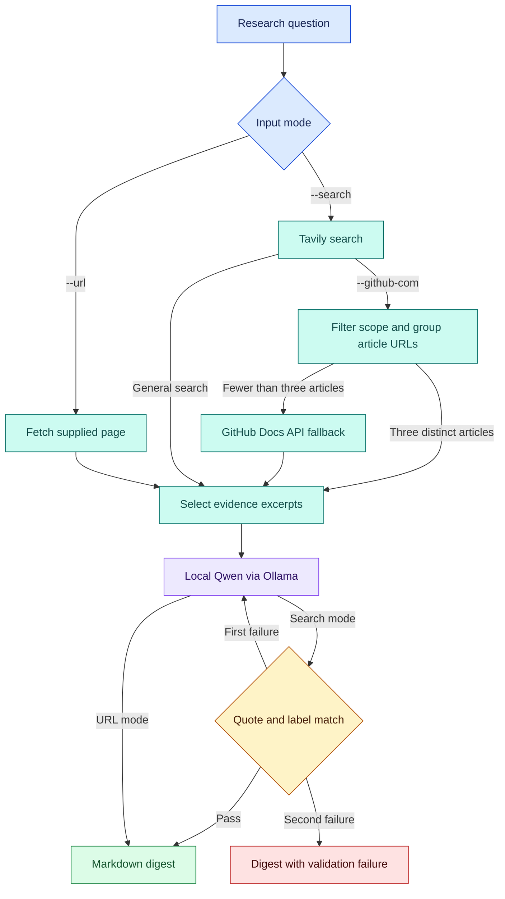

# 🔎 Personal Web Research Agent

A Python research agent that retrieves web evidence, runs Qwen locally through Ollama, and writes a timestamped Markdown digest. It demonstrates how to recover when search returns three URLs for a single article and how to check the quotes behind an answer.

## 🎨 Architecture



## 🧩 Extensions

### Implemented extensions

- [x] **1. Save and replay evidence.** Digests include a companion JSON file with source URLs, labels, exact excerpts, and the model responses and citation outcome for each search attempt. The [offline round-trip tests](tests/test_regressions.py) reproduce accepted citations, rejected citations, and insufficient evidence with HTTP calls disabled.

### Planned extensions

Move each verified extension to Implemented extensions and link its test or verification result.

- [ ] **2. Merge repeated findings.** Show a repeated finding once and preserve every supporting source and quote. **Complete when** the [retention regression](docs/live-regression.md) produces one public finding and one private/internal finding, each retaining its verified citations, and a test confirms that distinct scopes stay separate.
- [ ] **3. Add a claim-support evaluation set.** Include examples of fully supported claims, partly supported claims, wrong repository scopes, missing evidence, and quotations that appear in the excerpt but fail to establish the claim. **Complete when** an offline evaluation records quote matching and claim support separately against documented expected results.

## ⚙️ Existing capabilities

| Capability | Behavior | Verification |
| --- | --- | --- |
| 🔗 Direct URL research | Fetches a user-selected HTML page. Uses local Ollama and requires no Tavily key. | Live dependency-caching example and offline URL excerpt test |
| 🌐 Web search | Sends a question to Tavily and selects up to three source excerpts or snippets. | Live search with local Qwen |
| 🏷️ Product and version scope | `--github-com` keeps GitHub.com and Enterprise Cloud documentation and excludes versioned Enterprise Server pages. | Live scoped search and offline URL tests |
| 🔁 Article deduplication and fallback | In `--github-com` mode, groups locale and fragment variants of an article. GitHub Docs search can supplement the evidence when fewer than three distinct sources remain. | Live fallback and offline retrieval regression |
| 🧾 Citation validation | In search mode, checks that each quoted passage appears in its cited excerpt, allowing whitespace differences. | Live digest and offline wrong-source, unknown-label, and invented-quote cases |
| 🛑 Retry and abstention | Retries invalid citations once with the same evidence, then withholds claims if validation still fails. Reports insufficient evidence when the model produces no claims. | Offline retry and abstention cases, plus a live insufficient-evidence run |

## 🚀 Run on Windows

Prerequisites are Python 3.10+ and [Ollama](https://ollama.com/download). Run these commands from the repository directory in PowerShell. Start Ollama before generating a digest.

```powershell
py -m venv .venv
.\.venv\Scripts\python.exe -m pip install -r requirements.txt
ollama pull qwen3.5:4b
```

### 🔗 Research a supplied page

```powershell
.\.venv\Scripts\python.exe .\research_agent.py `
    --url "https://docs.github.com/en/actions/how-tos/manage-workflow-runs/download-workflow-artifacts" `
    "How long does GitHub retain workflow artifacts by default?"
```

### 🔍 Search with GitHub.com scope

Create a key in the [Tavily dashboard](https://app.tavily.com/). The example reads it with a masked prompt and clears it from the PowerShell session afterward. Search sends the question to Tavily and may also send it to GitHub Docs in scoped mode. Qwen generation runs on your machine.

```powershell
$tavilyKey = Read-Host "Paste your Tavily API key" -AsSecureString
try {
    $env:TAVILY_API_KEY = [pscredential]::new("tavily", $tavilyKey).GetNetworkCredential().Password

    .\.venv\Scripts\python.exe .\research_agent.py `
        --search --github-com `
        "On GitHub.com, what are the configurable GitHub Actions artifact retention ranges for public repositories and for private and internal repositories?"
}
finally {
    Remove-Item Env:TAVILY_API_KEY -ErrorAction SilentlyContinue
    Remove-Variable tavilyKey
}
```

Use `--search --domain example.org` for a different domain. The agent writes `digest-*.md` in the current directory.

### 🔁 Replay citation checks from a saved search

Each new digest links to its companion `digest-*.evidence.json` file. After a search run, copy the path printed on its `Evidence:` line and use it in this command:

```powershell
.\.venv\Scripts\python.exe .\research_agent.py --replay "path\to\digest.evidence.json"
```

Replay reads the saved excerpts and model replies, reruns citation validation for each attempt, and exits successfully when the original outcomes match. A recorded rejection can replay successfully. Replay runs offline and checks quote matching. Factual support still requires reviewing the claim against its evidence. Direct URL runs save the selected excerpt for review, while search runs also record structured citation attempts.

## 🧪 Verify offline

After installing the Python dependencies, run the tests without credentials, network calls, or a local model:

```powershell
.\.venv\Scripts\python.exe -m unittest discover -s tests -v
```

| Live case | Before the fallback | With the fallback |
| --- | --- | --- |
| GitHub.com artifact retention ranges | Three URLs pointed to one REST article. The agent reported insufficient evidence. | The GitHub Docs API supplied Enterprise Cloud excerpts with the applicable ranges. The quotes passed validation. |

See the [recorded live regression](docs/live-regression.md) and [BRI evaluation guide](docs/bri-evaluation.md).

## 🙌 Acknowledgment

Inspired by Darsh Shah’s freeCodeCamp tutorial [How to Build a Personal Web Research AI Agent with Ollama and Qwen](https://www.freecodecamp.org/news/build-a-personal-ai-web-research-agent-with-ollama-and-qwen/). This project uses Tavily for web discovery and adds product-scoped retrieval, article deduplication, an official [GitHub Docs API](https://docs.github.com/en/get-started/using-github-docs/github-docs-api) fallback, and quote validation.
