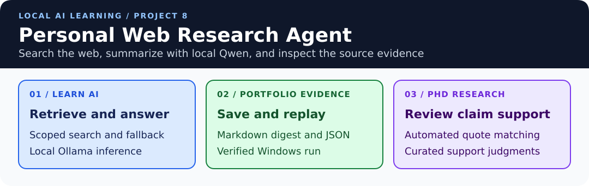
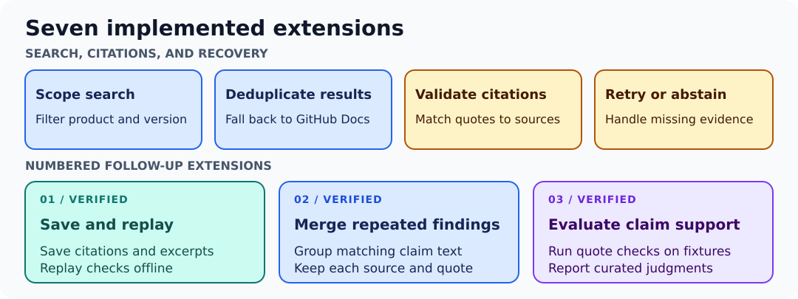
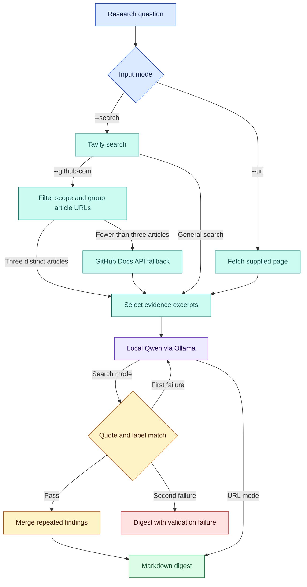
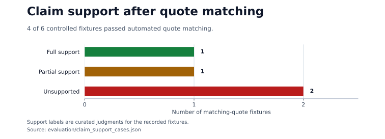

# 🔎 Personal Web Research Agent



**🟦 Learn AI · 🟩 Portfolio evidence · 🟪 PhD research**

A Python research agent that retrieves web evidence, runs Qwen locally through Ollama, and writes a timestamped Markdown digest. It demonstrates how to recover when search returns three URLs for a single article and how to check the quotes behind an answer.

<a id="explore-the-project"></a>

## 🧭 Explore the project

[🟦 Base tutorial](#base-tutorial) · [🧩 Contributions](#contributions) · [🗺️ Roadmap](#extension-roadmap) · [🏗️ Architecture](#architecture) · [🚀 Setup](#setup) · [🧪 Results & verification](#verification) · [🗂️ Evidence & guides](#claim-support-results) · [🟪 Thesis connection](#thesis-connection) · [🎨 Visual standard](https://github.com/anne500/multi-agent-study-guide/blob/main/VISUAL_STYLE.md)


[](docs/bri-evaluation.md#windows-verification)

<a id="-tutorial-baseline"></a>

<a id="base-tutorial"></a>

## 🟦 Base tutorial

Darsh Shah’s tutorial takes a research question from the terminal, searches the web through Ollama, and retrieves the top five pages. It uses Requests and BeautifulSoup to extract page text, then sends the text to local Qwen through Ollama and saves a timestamped Markdown digest. This project retains that question-to-digest workflow. [Darsh Shah’s freeCodeCamp tutorial: How to Build a Personal Web Research AI Agent with Ollama and Qwen](https://www.freecodecamp.org/news/build-a-personal-ai-web-research-agent-with-ollama-and-qwen/)

<a id="-project-extensions-and-contributions"></a>

<a id="-extensions-added-in-project-8"></a>

<a id="contributions"></a>

## 🧩 Tutorial baseline and contributions

<a id="extension-roadmap"></a>



Project #8 builds on one tutorial baseline with **two adaptations and seven extensions**. The adaptations change the tutorial’s retrieval path. The extensions add search controls, citation checks, recovery, and evidence evaluation.

### Implemented extensions

The numbered checklist covers the three follow-up extensions. The contribution table lists all seven.

- [x] **1. Save and replay evidence.** [Offline round-trip tests](tests/test_regressions.py)
- [x] **2. Merge repeated findings.** [Offline retention regression](docs/live-regression.md#offline-merge-regression)
- [x] **3. Add a claim-support evaluation set.** [Six offline evaluation cases](docs/bri-evaluation.md#claim-support-evaluation)

### Baseline and contribution table

| Origin | Item | Scope or contribution | Verification |
| --- | --- | --- | --- |
| 🟦 Tutorial baseline | [Base tutorial](#base-tutorial) | Ollama web search, webpage text extraction, local Qwen summarization, and a timestamped Markdown digest. | See the [tutorial baseline](#base-tutorial). |
| 🛠️ Adaptation | 🔗 Direct URL research | Added `--url` to analyze a supplied page with local Qwen without a Tavily key. | Live dependency-caching question and offline URL excerpt test |
| 🛠️ Adaptation | 🌐 Tavily web search | Replaced Ollama web search with Tavily, with optional domain filtering and up to three excerpts or snippets. | Live retention regression |
| 🧩 Implemented extension | 🏷️ Product and version scope | `--github-com` keeps GitHub.com and Enterprise Cloud documentation and excludes versioned Enterprise Server pages. | Live scoped search and offline URL tests |
| 🧩 Implemented extension | 🔁 Article deduplication and fallback | In `--github-com` mode, groups locale and fragment variants of an article. GitHub Docs search can supplement the evidence when fewer than three distinct sources remain. | Live fallback and offline retrieval regression |
| 🧩 Implemented extension | 🧾 Citation validation | In search mode, checks that each quoted passage appears in its cited excerpt, allowing whitespace differences. | Live digest and offline wrong-source, unknown-label, and invented-quote cases |
| 🧩 Implemented extension | 🛑 Retry and abstention | Retries invalid citations once with the same evidence, then withholds claims if validation still fails. Reports insufficient evidence when the model produces no claims. | Offline retry and abstention cases, plus a live insufficient-evidence run |
| 🧩 Implemented extension | 💾 Save and replay evidence | Saves source URLs, labels, exact excerpts, model responses, and citation outcomes. Replays each search attempt against the stored evidence. | [Offline tests](tests/test_regressions.py) cover accepted and rejected citations and insufficient evidence with HTTP calls disabled. |
| 🧩 Implemented extension | 🔗 Merge repeated findings | Groups matching claim wording after limited formatting normalization and keeps all distinct source and quote pairs. | Two findings and four citations in the [offline retention regression](docs/live-regression.md#offline-merge-regression) |
| 🧩 Implemented extension | 🧪 Claim-support evaluation set | Reports automated quote checks alongside curated factual-support judgments. | [Six offline cases](docs/bri-evaluation.md#claim-support-evaluation) |

The live retention regression shows what the added retrieval and citation controls changed for one GitHub.com policy question. The BRI evaluation guide explains how to assess source applicability, quote matching, and claim support as separate checks. [Live regression](docs/live-regression.md) · [BRI evaluation guide](docs/bri-evaluation.md)

<a id="architecture"></a>

## 🧩 Architecture



<a id="setup"></a>

## 🚀 Run on Windows

Prerequisites are Python 3.10+ and [Ollama](https://ollama.com/download). Run these commands from the repository directory in PowerShell. Start Ollama before generating a digest.

```powershell
py -m venv .venv
.\.venv\Scripts\python.exe -m pip install -r requirements.txt
ollama pull qwen3.5:4b
```

### 🔗 Research a supplied page

```powershell
.\.venv\Scripts\python.exe .\research_agent.py `
    --url "https://docs.github.com/en/actions/how-tos/manage-workflow-runs/download-workflow-artifacts" `
    "How long does GitHub retain workflow artifacts by default?"
```

### 🔍 Search with GitHub.com scope

Create a key in the [Tavily dashboard](https://app.tavily.com/). The example reads it with a masked prompt and clears it from the PowerShell session afterward. Search sends the question to Tavily and may also send it to GitHub Docs in scoped mode. Qwen generation runs on your machine.

```powershell
$tavilyKey = Read-Host "Paste your Tavily API key" -AsSecureString
try {
    $env:TAVILY_API_KEY = [pscredential]::new("tavily", $tavilyKey).GetNetworkCredential().Password

    .\.venv\Scripts\python.exe .\research_agent.py `
        --search --github-com `
        "On GitHub.com, what are the configurable GitHub Actions artifact retention ranges for public repositories and for private and internal repositories?"
}
finally {
    Remove-Item Env:TAVILY_API_KEY -ErrorAction SilentlyContinue
    Remove-Variable tavilyKey
}
```

Use `--search --domain example.org` for a different domain. The agent writes `digest-*.md` in the current directory.

### 🔁 Replay citation checks from a saved search

Each new digest links to its companion `digest-*.evidence.json` file. After a search run, copy the path printed on its `Evidence:` line and use it in this command:

```powershell
.\.venv\Scripts\python.exe .\research_agent.py --replay "path\to\digest.evidence.json"
```

Replay reads the saved excerpts and model replies, reruns citation validation for each attempt, and exits successfully when the original outcomes match. A recorded rejection can replay successfully. Replay runs offline and checks quote matching. Factual support still requires reviewing the claim against its evidence. Direct URL runs save the selected excerpt for review, while search runs also record structured citation attempts.

<a id="verification"></a>

## 🧪 Verify offline

After installing the Python dependencies, run the tests without credentials, network calls, or a local model:

```powershell
.\.venv\Scripts\python.exe -m unittest discover -s tests -v
.\.venv\Scripts\python.exe .\evaluate_claim_support.py
```

| Live case | Before the fallback | With the fallback |
| --- | --- | --- |
| GitHub.com artifact retention ranges | Three URLs pointed to one REST article. The agent reported insufficient evidence. | The GitHub Docs API supplied Enterprise Cloud excerpts with the applicable ranges. The quotes passed validation. |

See the [recorded live regression](docs/live-regression.md) and [BRI evaluation guide](docs/bri-evaluation.md).

<a id="claim-support-results"></a>

### 📊 Claim-support results



The chart covers the four matching-quote cases from the six controlled fixtures. The support labels come from curated review judgments. [Windows verification](docs/bri-evaluation.md#windows-verification) · [Source cases](evaluation/claim_support_cases.json) · [Plotting script](scripts/plot_verification.py)

<a id="thesis-connection"></a>

## 🟪 Thesis connection

For Build Release and Integration Engineering, exact evidence replay can make a CI or release-policy digest easier to audit. The six curated cases demonstrate the distinction between quote matching and factual support. A follow-up study would apply those checks to actual build and release records with independent human ratings.

<a id="tutorial-credit"></a>

<a id="-acknowledgment"></a>

## 📚 Tutorial Acknowledgment and Attribution

Thanks to Darsh Shah for the freeCodeCamp tutorial that provided the starting workflow.
