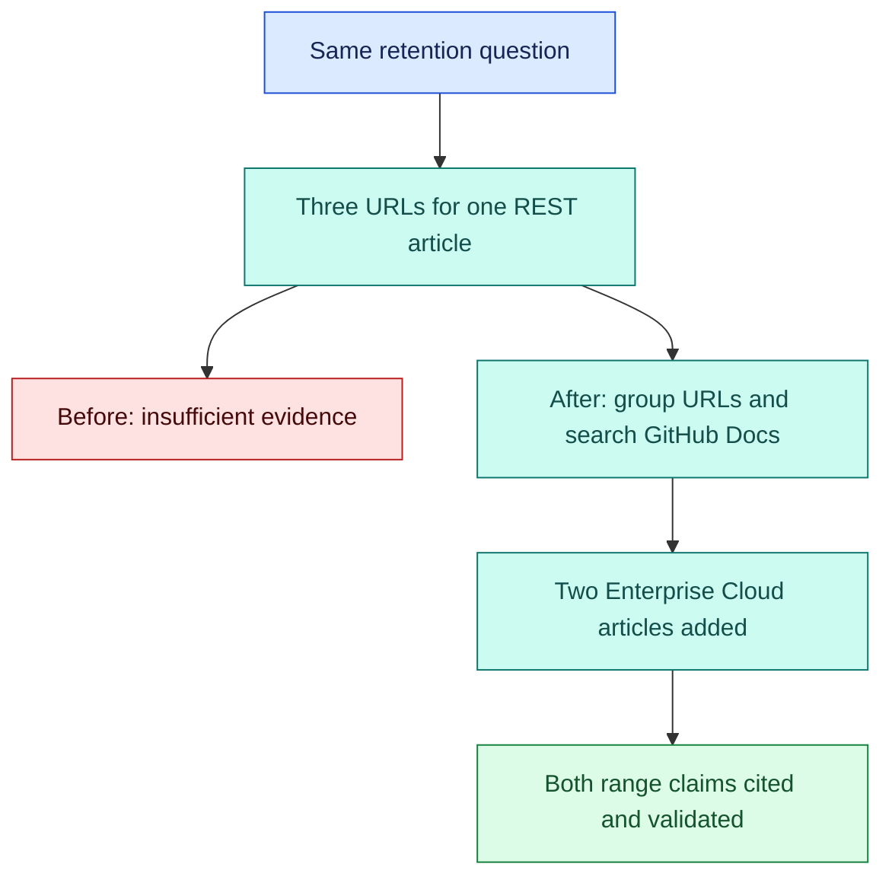

# 🧪 Live regression evidence

Windows PowerShell run on November 14, 2026 using Tavily, the GitHub Docs API, and local Ollama with `qwen3.5:4b`. This record summarizes the user’s console transcript.

## 🟠 Before article deduplication and fallback

- Retrieval returned a Chinese locale URL and two English fragment URLs for the same REST permissions article.
- The excerpts lacked the requested ranges. The agent reported insufficient evidence and saved a digest.
- Original digest filename: `digest-20261114-170057-456586.md`.

## 🟢 After article deduplication and fallback

The agent grouped the three URLs, retrieved two Enterprise Cloud articles through the GitHub Docs API, and passed its quote check. Original digest filename: `digest-20261114-171914-485057.md`.

| Claim in digest | Value | Evidence |
| --- | --- | --- |
| Public repositories | 1–90 days | [S2, retention policy](https://docs.github.com/en/enterprise-cloud@latest/admin/enforcing-policies/enforcing-policies-for-your-enterprise/enforcing-policies-for-github-actions-in-your-enterprise#check-workflow-run-status-artifact-and-log-retention) |
| Private and internal repositories | 1–400 days | [S2, retention policy](https://docs.github.com/en/enterprise-cloud@latest/admin/enforcing-policies/enforcing-policies-for-your-enterprise/enforcing-policies-for-github-actions-in-your-enterprise#check-workflow-run-status-artifact-and-log-retention) |

The live digest repeated both claims for [S3, repository settings](https://docs.github.com/en/enterprise-cloud@latest/repositories/managing-your-repositorys-settings-and-features/enabling-features-for-your-repository/managing-github-actions-settings-for-a-repository). This presentation issue is open. The [offline tests](../tests/test_regressions.py) use simulated service responses and can be rerun independently of the live example.
