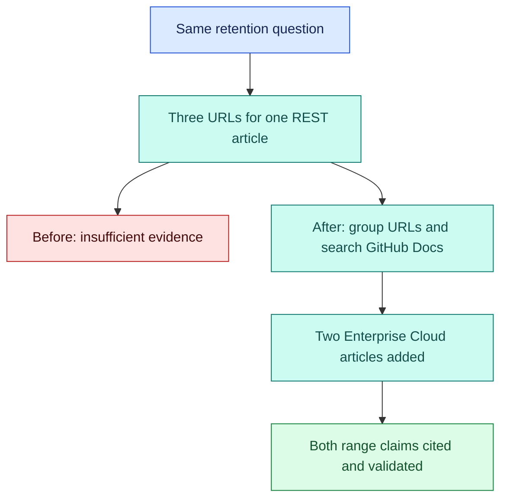

# 🧪 Live regression evidence

Windows PowerShell run on November 14, 2026 using Tavily, the GitHub Docs API, and local Ollama with `qwen3.5:4b`. This record summarizes the user’s console transcript.

## 🟠 Before article deduplication and fallback

- Retrieval returned a Chinese locale URL and two English fragment URLs for the same REST permissions article.
- The excerpts lacked the requested ranges. The agent reported insufficient evidence and saved a digest.
- Original digest filename: `digest-20261114-170057-456586.md`.

## 🟢 After article deduplication and fallback

The agent grouped the three URLs, retrieved two Enterprise Cloud articles through the GitHub Docs API, and passed its quote check. Original digest filename: `digest-20261114-171914-485057.md`.

| Claim in digest | Value | Evidence |
| --- | --- | --- |
| Public repositories | 1–90 days | [S2, retention policy](https://docs.github.com/en/enterprise-cloud@latest/admin/enforcing-policies/enforcing-policies-for-your-enterprise/enforcing-policies-for-github-actions-in-your-enterprise#check-workflow-run-status-artifact-and-log-retention) |
| Private and internal repositories | 1–400 days | [S2, retention policy](https://docs.github.com/en/enterprise-cloud@latest/admin/enforcing-policies/enforcing-policies-for-your-enterprise/enforcing-policies-for-github-actions-in-your-enterprise#check-workflow-run-status-artifact-and-log-retention) |

The live digest repeated both claims for [S3, repository settings](https://docs.github.com/en/enterprise-cloud@latest/repositories/managing-your-repositorys-settings-and-features/enabling-features-for-your-repository/managing-github-actions-settings-for-a-repository).

## 🔗 Offline merge regression

The regression recreates the two retention ranges with controlled excerpts and four validated citations. It exercises the search digest renderer with one modeled response.

| Scope | Before grouping | After grouping | Citations retained |
| --- | ---: | ---: | --- |
| Public repositories | 2 findings | 1 finding | S2 and S3, with one quote each |
| Private and internal repositories | 2 findings | 1 finding | S2 and S3, with one quote each |

The renderer matches repeated wording and normalizes numeric range typography and a final period. Scope, values, units, and qualifiers stay in the comparison. The model prompt asks for the same claim wording across sources to support grouping. Paraphrases with different wording can still display separately. The saved evidence retains the original model reply. [Regression tests](../tests/test_regressions.py)
